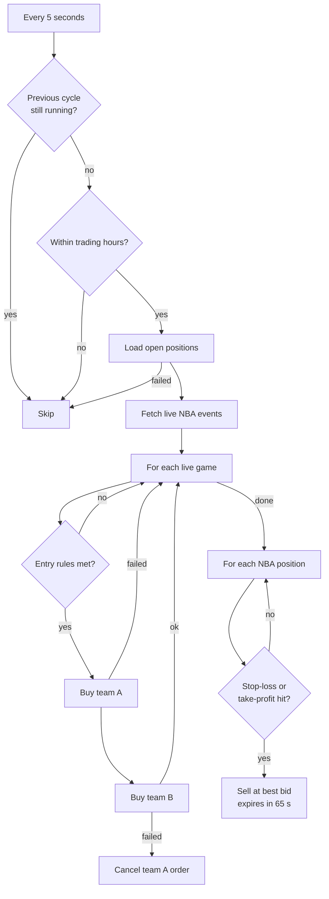
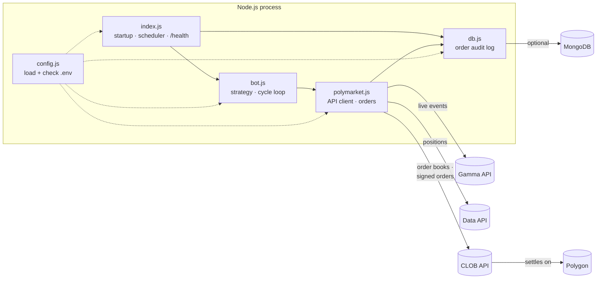

<div align="center">

# 🏀 Polymarket NBA Bot Starter

**An automated, fail-safe trading bot for live NBA prediction markets on [Polymarket](https://polymarket.com).**

It trades in real time on Polygon through Polymarket's order book (CLOB) API. It is configured entirely through environment variables, and it runs in **dry-run mode** by default.

[](https://github.com/rafiulhc/polymarket-nba-bot-starter/actions/workflows/ci.yml)
[](#testing)
[](https://nodejs.org)
[](https://docs.polymarket.com)
[](https://polygon.technology)
[](https://www.mongodb.com)
[](LICENSE)

[Quick start](#quick-start) · [How it works](#how-it-works) · [Architecture](#architecture) · [Engineering decisions](#engineering-decisions) · [Testing](#testing) · [Configuration](#configuration)

</div>

---

> [!WARNING]
> With `DRY_RUN=false`, this bot trades **real money**. Prediction markets are risky, and this strategy **can and will lose money** in some games. Nothing here is financial advice. Use it only where Polymarket is legally available to you.

## ✨ Highlights

- **⚡ Real-time trading:** checks every live NBA game every 5 seconds and places signed orders through Polymarket's order book.
- **🧪 Dry-run by default:** the whole pipeline runs, but orders are logged instead of sent. Real trading needs an explicit `DRY_RUN=false`.
- **🛡️ Fails safe:** guards against overlapping runs, duplicate entries, one-sided positions and stacked orders. When it's unsure, it does nothing.
- **⚙️ Settings in `.env`, not code:** 20+ strategy and schedule settings, checked at startup.
- **🗄️ Order audit log:** optional MongoDB log of every order, real or simulated, with the full API response.
- **✅ Tested:** 50 tests cover every entry rule, exit rule and safety guard, and run in CI on Node 20 and 22. No network, wallet or database needed.
- **📦 Easy to deploy:** one `Procfile` for Heroku, plus a `/health` endpoint for uptime checks.

---

<a id="quick-start"></a>

## 🚀 Quick start

**Requirements:** Node.js 20+, a Polymarket account with USDC in its proxy wallet, and [Polymarket CLOB API credentials](https://docs.polymarket.com).

```bash
git clone https://github.com/rafiulhc/polymarket-nba-bot-starter.git
cd polymarket-nba-bot-starter
npm install
cp .env.example .env   # add your credentials
npm start
```

```text
DRY RUN mode: orders are logged, not placed. Set DRY_RUN=false to trade.
MONGODB_URI not set, order logging to MongoDB is disabled.
Health check on port 3312
Live NBA events: 3
Lakers vs Celtics: ~1h 12m left, spread 0.01
Lakers vs Celtics: best asks 0.49 / 0.52
Lakers vs Celtics: entry rules met, buying both teams.
[DRY RUN] would place order { tokenID: '…', price: 0.5, side: 'BUY', size: 100, orderType: 'GTC' }
```

Watch it during a few live games. When you trust what it would have done, set `DRY_RUN=false`.

| Command | Purpose |
|---|---|
| `npm start` | Run the bot |
| `npm run dev` | Run the bot and restart it on code changes (nodemon) |
| `npm test` | Run the test suite (about 0.2 s, fully offline) |
| `curl localhost:3312/health` | Check that the bot is running → `{"ok":true,"dryRun":true}` |

---

<a id="how-it-works"></a>

## 🧠 How it works

### The strategy

While a game is live and still close, the bot **buys both teams**. Then it **exits each side separately**:

- **Stop-loss:** when a team's price falls to **0.25 or below**, it's probably losing, so sell what's left.
- **Take-profit:** when a team's price rises to **0.96 or above**, it has almost certainly won, so sell near $1.

This is **not arbitrage**. Holding both sides costs about $1, which is roughly what they pay out. The profit comes entirely from the exit rules, so this is a bet that **games break one way and stay that way**.

| Scenario ($50 per side at 0.50) | Loser exits at | Winner exits at | P&L |
|---|---|---|---|
| ✅ Clear winner | 0.25 → $25 | 0.96 → $96 | **+$21** |
| ⚠️ Price gaps past the stop-loss | 0.10 → $10 | 0.96 → $96 | **+$6** |
| ❌ Comeback (both sides hit the stop-loss) | 0.25 → $25 | 0.25 → $25 | **−$50** |

### One cycle



### Entry rules

The bot buys a game only when **all** of these are true:

| Rule | Default | Why |
|---|---|---|
| Game is live | less than 111 min after tip-off | Only live games move enough |
| No position or open order in this game | — | Never doubles up |
| Market spread | ≤ 0.05 | Skips illiquid markets |
| Each team's best ask | 0.30 – 0.70 | The game is still competitive |
| Sum of both best asks | ≤ 1.02 | Holding both sides costs about $1 |

---

<a id="architecture"></a>

## 🏗 Architecture



| Module | Responsibility | Knows about |
|---|---|---|
| [`index.js`](index.js) | Starts the bot, schedules cycles, serves `/health` | Everything, at the top level only |
| [`src/config.js`](src/config.js) | Loads `.env`, applies defaults, checks types and required values | Nothing else |
| [`src/bot.js`](src/bot.js) | **The strategy:** entry rules, exit rules, cycle loop | `polymarket.js`, not the HTTP or SDK details |
| [`src/polymarket.js`](src/polymarket.js) | All external API calls, order signing and dry-run handling | `config.js`, `db.js` |
| [`src/db.js`](src/db.js) | Optional order audit log | `config.js` |
| [`test/`](test) | Offline test suite with fakes for every external dependency | — |

The strategy module never calls an API directly. That keeps the trading logic readable, makes it possible to test with a fake client, and means you can change the strategy without touching the order code.

---

<a id="engineering-decisions"></a>

## 🧩 Engineering decisions

The hard part of a trading bot isn't the strategy. It's making sure the bot **never does something you didn't intend**. Each guard below targets a specific way the bot could lose money:

| Way it could go wrong | Guard | Where |
|---|---|---|
| A slow cycle overlaps the next one, and both buy the same game | A lock (`isRunning`) skips a cycle while the previous one is still going | `bot.js` → `tick()` |
| The positions API fails, so the bot thinks it holds nothing and buys again | **Fails closed:** returns `null` (not `[]`) on error, and the cycle is skipped | `polymarket.js` → `fetchPositions()` |
| The first buy fills and the second fails, leaving only one team | The second order is placed only if the first succeeded. If the second fails, the first is cancelled | `bot.js` → `tryEnterGame()` |
| The positions API lags behind a fill, and the bot buys again | Bought tokens are also tracked in memory, and open orders are checked before buying | `bot.js` → `boughtTokens` |
| A sell from the previous cycle is still open, and another is placed | Positions with open orders are skipped | `bot.js` → `manageExits()` |
| A stale sell order fills at a bad price minutes later | Sells are good-till-date orders that expire after 65 s | `polymarket.js` → `sell()` |
| Paying the second-best ask buys more than intended | The number of shares is calculated from the actual order price and **rounded down**, so each side costs at most `USD_PER_SIDE` | `bot.js` → `tryEnterGame()` |
| One bad market or position stops all the others | Each game and each position runs in its own try/catch | `bot.js` |
| A logging outage stops trading | Database errors are logged and ignored, so trading continues | `db.js` → `logOrder()` |
| A typo in `.env` (e.g. `USD_PER_SIDE=5O`) trades with a wrong value | Settings are checked at startup, and the bot stops with a clear message | `config.js` |
| Someone clones the repo and trades real money by accident | `DRY_RUN` is `true` unless it's explicitly set to `false` | `config.js` |
| Secrets end up in git | All credentials come from the environment, and `.env*` is ignored by git except for the template | `.gitignore` |

Every guard in this table has a test that fails if the guard is removed. See [Testing](#testing).

---

<a id="testing"></a>

## 🧪 Testing

```bash
npm test
```

```text
# tests 50
# suites 9
# pass 50
# fail 0
# duration_ms 210
```

The suite uses Node's built-in test runner (`node:test`), so there are **no extra test dependencies**. It runs **fully offline**: each module is tested on its own, with fakes in place of Polymarket, the network, MongoDB and `.env`. No real orders, wallets or credentials are ever involved.

| File | What it covers |
|---|---|
| [`test/bot.test.js`](test/bot.test.js) | Every entry rule (buy and skip cases) · exit rules (stop-loss, take-profit, hold) · overlapping cycles · failing closed · one-sided buys and cancellation · no re-buying · no stacked sells · error isolation · trading hours |
| [`test/polymarket.test.js`](test/polymarket.test.js) | Dry-run never signs or sends orders · GTC buys and GTD sells with the correct expiry · rejected and failed orders return `null` · positions return `null` (not `[]`) on any failure · live NBA filtering |
| [`test/config.test.js`](test/config.test.js) | Dry-run default · required credentials · number checking · defaults and overrides |
| [`test/db.test.js`](test/db.test.js) | Logging is off without `MONGODB_URI` · records include `dryRun` and `createdAt` · write failures never throw |

**The tests catch real bugs.** Putting known bugs back into the code makes the suite fail:

| Bug put back in | Result |
|---|---|
| Rounding the number of shares up instead of down | ❌ 2 tests fail |
| Removing the overlapping-cycle lock | ❌ 1 test fails |
| Returning `[]` instead of `null` when the positions API fails | ❌ 1 test fails |

Writing the tests also uncovered a real bug: rounding the number of shares to the *nearest* cent could spend slightly more than `USD_PER_SIDE` (e.g. $20.0022 instead of $20). It's now rounded down.

[GitHub Actions](.github/workflows/ci.yml) runs a syntax check and the full suite on Node 20 and 22 for every push and pull request.

---

<a id="configuration"></a>

## ⚙️ Configuration

Copy [`.env.example`](.env.example) to `.env`. Only the Polymarket credentials are required. Everything else has a sensible default.

<details open>
<summary><b>Required</b></summary>

| Variable | Description |
|---|---|
| `CLOB_API_KEY` | Polymarket CLOB API key |
| `CLOB_SECRET` | CLOB API secret |
| `CLOB_PASS_PHRASE` | CLOB API passphrase |
| `PRIVATE_KEY` | Private key of the wallet that signs orders |
| `PROXY_ADDRESS` | Your Polymarket proxy wallet address, also used to read positions |

</details>

<details>
<summary><b>General</b></summary>

| Variable | Default | Description |
|---|---|---|
| `DRY_RUN` | `true` | Set to `false` to place real orders |
| `CLOB_API_URL` | `https://clob.polymarket.com` | CLOB endpoint |
| `MONGODB_URI` | *(empty)* | Turns on the order audit log |
| `MONGODB_DB` | `polymarket` | Database name |
| `PORT` | `3312` | Port for `/health` |

</details>

<details>
<summary><b>Schedule</b></summary>

| Variable | Default | Description |
|---|---|---|
| `INTERVAL_MS` | `5000` | Time between cycles, in milliseconds |
| `TRADING_TIMEZONE` | `America/Los_Angeles` | Timezone for trading hours |
| `TRADING_START_HOUR` | `10` | First trading hour (inclusive) |
| `TRADING_END_HOUR` | `22` | Last trading hour (exclusive) |

</details>

<details>
<summary><b>Strategy</b></summary>

| Variable | Default | Description |
|---|---|---|
| `USD_PER_SIDE` | `50` | Maximum spent on each team |
| `MAX_ENTRY_SPREAD` | `0.05` | Maximum market spread to enter |
| `MIN_ENTRY_PRICE` | `0.30` | Lowest best ask allowed for either team |
| `MAX_ENTRY_PRICE` | `0.70` | Highest best ask allowed for either team |
| `MAX_COMBINED_ASK` | `1.02` | Maximum sum of both best asks |
| `STOP_LOSS_PRICE` | `0.25` | Sell when the best bid is at or below this |
| `TAKE_PROFIT_PRICE` | `0.96` | Sell when the best bid is at or above this |
| `MAX_EXIT_SPREAD` | `0.06` | Maximum spread to place a sell |
| `SELL_ORDER_TTL_SECONDS` | `65` | How long a sell order stays open |
| `GAME_DURATION_MINUTES` | `111` | Assumed game length after tip-off |

</details>

---

## 🗄 Order audit log (MongoDB)

Set `MONGODB_URI` and every order goes into the `orders` collection. A free [Atlas](https://www.mongodb.com/atlas) cluster is enough.

```json
{
  "tokenID": "7132…",
  "side": "BUY",
  "price": 0.5,
  "size": 100,
  "orderType": "GTC",
  "success": true,
  "response": { "orderID": "0x…", "status": "matched" },
  "dryRun": false,
  "createdAt": "2026-10-06T19:42:11.000Z"
}
```

Dry-run orders are logged too, with `dryRun: true`, so you can compare simulated and real behaviour.

> [!IMPORTANT]
> Connection strings contain your database password. Keep them in `.env` or your host's config, **never in code**. In Atlas, restrict **Network Access** to your server's IP.

---

## ☁️ Deployment

### Heroku

```bash
heroku create
heroku config:set DRY_RUN=true CLOB_API_KEY=... CLOB_SECRET=... CLOB_PASS_PHRASE=... PRIVATE_KEY=... PROXY_ADDRESS=...
git push heroku main
heroku logs --tail
```

### Any VPS (Docker, Railway, Fly.io, EC2…)

The bot is a single Node.js process. Run `npm start` with the environment variables set, and point health checks at `GET /health`.

> [!CAUTION]
> Run **exactly one instance**. Separate instances don't share state and could both enter the same game.

---

## ⚠️ Risks & limitations

**Market risks**
- **Comebacks:** the worst case for one game is losing about half of what you put in.
- **Fast price moves:** in-game prices can jump past the stop-loss in a single play.
- **Partial fills:** an order that only partly fills before it's cancelled leaves an uneven position.
- **Platform risk:** funds sit in a Polymarket proxy wallet on Polygon. API outages stop exits until the APIs recover.

**Current limitations**
- Buy orders are good-till-cancelled and stay open until they fill or are cancelled.
- Game time is estimated from tip-off, not from the real game clock, so overtime can throw it off.
- In dry-run mode, positions never change, so the same exit may be logged on every cycle.
- Bot state is kept in memory and lost on restart. Positions are reloaded from Polymarket, so this doesn't cause duplicate buys.

---

## 🗺 Roadmap

- [x] Unit tests for entry rules, exit rules and every safety guard
- [x] GitHub Actions CI on Node 20 and 22
- [ ] Linting with ESLint and Prettier
- [ ] Dockerfile
- [ ] Backtesting from recorded order-book snapshots
- [ ] Live score and game clock from a sports data API
- [ ] Telegram or Discord alerts on fills and daily P&L
- [ ] Risk limits: maximum open games and a daily loss limit that stops the bot
- [ ] Support for other two-outcome live markets (NFL, soccer, esports)

Contributions are welcome. Open an issue to discuss a change first.

---

## 🛠 Tech stack

| Area | Tools |
|---|---|
| Runtime | Node.js 20, Express |
| Trading | `@polymarket/clob-client`, `@polymarket/order-utils`, `ethers` v5 (EIP-712 order signing) |
| Data | Polymarket Gamma API (markets), Data API (positions), CLOB API (order books and orders) |
| Storage | MongoDB (optional audit log) |
| Testing | `node:test`, `node:assert`, fakes injected through the require cache |
| Ops | GitHub Actions CI, dotenv, Heroku `Procfile`, `/health` endpoint |

---

## 👤 Author

**Rafiul Hasan Chowdhury** · [GitHub @rafiulhc](https://github.com/rafiulhc)

If this project helped you, consider giving it a ⭐.

## 📄 License

[MIT](LICENSE). Provided **as is**, with no warranty. You are responsible for your own trades, your losses, and following Polymarket's terms and the laws where you live.
