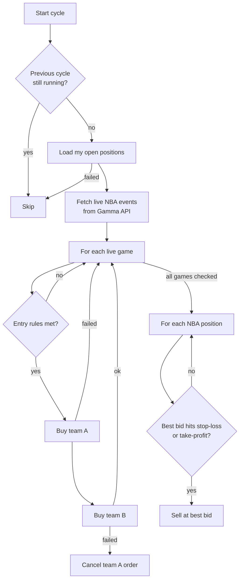

# Polymarket NBA Bot Starter

A clean, configurable starter template for an automated trading bot on **live NBA game markets on [Polymarket](https://polymarket.com)**.

While a game is in progress, the bot looks for evenly priced matchups, buys **both** teams, and then exits each side when the game breaks one way: it cuts the losing team early and sells the winning team close to $1.

- 🧪 **Dry-run by default.** It logs what it would trade until you explicitly turn trading on.
- ⚙️ **Every strategy setting is configurable** through environment variables, so there's no need to edit code.
- 🗄️ **Optional MongoDB logging** of every order, both real and dry-run.
- 🛡️ **Built-in safety guards** against double-buying, one-sided positions and stacked orders.

> [!WARNING]
> With `DRY_RUN=false`, this bot trades real money. Prediction markets are risky, and this strategy **can and will lose money** in some games. Nothing here is financial advice. Run it in dry-run mode first, then with small amounts, and only if Polymarket is legally available to you where you live.

---

## Table of contents

- [Quick start](#quick-start)
- [How it works](#how-it-works)
- [The strategy in numbers](#the-strategy-in-numbers)
- [Configuration](#configuration)
- [MongoDB order logging](#mongodb-order-logging)
- [Deploying to Heroku](#deploying-to-heroku)
- [Safety features](#safety-features)
- [Risks](#risks)
- [Known limitations](#known-limitations)
- [Project structure](#project-structure)
- [Ideas for extending it](#ideas-for-extending-it)

---

## Quick start

**Requirements:** Node.js 20+, a Polymarket account with USDC in its proxy wallet, and Polymarket CLOB API credentials.

```bash
git clone https://github.com/<your-username>/polymarket-nba-bot-starter.git
cd polymarket-nba-bot-starter
npm install
cp .env.example .env     # then fill in your credentials
npm start
```

The bot starts in **dry-run mode**:

```text
DRY RUN mode: orders are logged, not placed. Set DRY_RUN=false to trade.
```

Watch it during a few live games. When you're happy with what it would have done, set `DRY_RUN=false` in `.env`.

| Command | What it does |
|---|---|
| `npm start` | Runs the bot |
| `npm run dev` | Runs the bot and restarts it when the code changes |

---

## How it works

Every 5 seconds during trading hours (by default **10 AM – 10 PM Pacific**), the bot runs one cycle:



### Entry: when the bot buys

The bot buys both teams in a game only when **all** of these are true:

| Rule | Default | Why |
|---|---|---|
| Game is in progress | started, and less than 111 min ago | Only live games move enough |
| No position or open order in this game | — | Never doubles up |
| Market spread | ≤ 0.05 | Avoids illiquid markets |
| Each team's best ask | 0.30 – 0.70 | The game is still close |
| Sum of both best asks | ≤ 1.02 | Keeps the cost of holding both sides near $1 |

Each side is bought for up to **$50**, priced at the second-best ask so that the order fills.

### Exit: when the bot sells

Each position is sold separately when its best bid reaches:

- **≤ 0.25** (stop-loss): this team is probably losing, so sell what's left.
- **≥ 0.96** (take-profit): this team has almost certainly won, so take the profit.

Sell orders are only placed when the spread is ≤ 0.06. They expire after 65 seconds, so a stale price never sits on the order book.

---

## The strategy in numbers

This is **not arbitrage**. Buying both sides for ~$1.00 combined is break-even at best. All of the profit comes from the exit rules.

Example with both teams at 0.50 and $50 per side (100 shares each):

| Game outcome | Losing side sold at | Winning side sold at | Result |
|---|---|---|---|
| ✅ Clear winner, no comeback | 0.25 → **$25** | 0.96 → **$96** | **+$21** |
| ❌ Comeback (team A drops to 0.25, then wins) | Team A at 0.25 → **$25** | Team B also drops to 0.25 → **$25** | **−$50** |
| ⚠️ Price gaps past the stop-loss | e.g. 0.10 → **$10** | 0.96 → **$96** | **+$6** |

The strategy makes money when games break one way and stay that way. Comebacks are what lose money. Tune the thresholds in [Configuration](#configuration) to change that trade-off.

---

## Configuration

All settings live in `.env`. See [`.env.example`](.env.example) for a ready-to-copy template.

### Required

| Variable | Description |
|---|---|
| `CLOB_API_KEY` | Polymarket CLOB API key |
| `CLOB_SECRET` | CLOB API secret |
| `CLOB_PASS_PHRASE` | CLOB API passphrase |
| `PRIVATE_KEY` | Private key of the wallet that signs orders |
| `PROXY_ADDRESS` | Your Polymarket proxy wallet address, also used to read your positions |

If any of these are missing, the bot stops at startup and tells you which one.

### General

| Variable | Default | Description |
|---|---|---|
| `DRY_RUN` | `true` | Set to `false` to place real orders |
| `CLOB_API_URL` | `https://clob.polymarket.com` | CLOB endpoint |
| `MONGODB_URI` | *(empty)* | Optional. See [MongoDB order logging](#mongodb-order-logging) |
| `MONGODB_DB` | `polymarket` | Database name for order logs |
| `PORT` | `3312` | Port for the `/health` endpoint |

### Schedule

| Variable | Default | Description |
|---|---|---|
| `INTERVAL_MS` | `5000` | Time between cycles, in milliseconds |
| `TRADING_TIMEZONE` | `America/Los_Angeles` | Timezone for trading hours |
| `TRADING_START_HOUR` | `10` | First trading hour (inclusive) |
| `TRADING_END_HOUR` | `22` | Last trading hour (exclusive) |

### Strategy

| Variable | Default | Description |
|---|---|---|
| `USD_PER_SIDE` | `50` | Maximum spent on each team |
| `MAX_ENTRY_SPREAD` | `0.05` | Maximum market spread to enter |
| `MIN_ENTRY_PRICE` | `0.30` | Lowest best ask allowed for either team |
| `MAX_ENTRY_PRICE` | `0.70` | Highest best ask allowed for either team |
| `MAX_COMBINED_ASK` | `1.02` | Maximum sum of both best asks |
| `STOP_LOSS_PRICE` | `0.25` | Sell when the best bid falls to or below this |
| `TAKE_PROFIT_PRICE` | `0.96` | Sell when the best bid rises to or above this |
| `MAX_EXIT_SPREAD` | `0.06` | Maximum spread to place a sell |
| `SELL_ORDER_TTL_SECONDS` | `65` | How long a sell order stays open |
| `GAME_DURATION_MINUTES` | `111` | Assumed game length after tip-off |

---

## MongoDB order logging

Set `MONGODB_URI` to log every order to the `orders` collection. This works with a free [MongoDB Atlas](https://www.mongodb.com/atlas) cluster:

```dotenv
MONGODB_URI=mongodb+srv://<user>:<password>@<cluster>.mongodb.net/
```

Each record contains the token, side, price, size, order type, success flag, Polymarket's response or error, `dryRun`, and `createdAt`.

Logging is **optional and can't break trading**. If `MONGODB_URI` is empty, logging is turned off. If a write fails, the error is printed and the bot carries on.

> [!IMPORTANT]
> Keep your connection string in `.env` or your host's config, **never in code**. Connection strings contain your database password. In Atlas, also restrict **Network Access** to your server's IP instead of `0.0.0.0/0`.

---

## Deploying to Heroku

The included `Procfile` runs the bot as a web dyno. The small Express server exposes `GET /health` so the host can see the app is up.

```bash
heroku create
heroku config:set DRY_RUN=true CLOB_API_KEY=... CLOB_SECRET=... CLOB_PASS_PHRASE=... PRIVATE_KEY=... PROXY_ADDRESS=...
git push heroku main
heroku logs --tail
```

Run only **one** instance. Two copies of the bot don't know about each other and could both buy the same game.

---

## Safety features

| Guard | What it prevents |
|---|---|
| **Dry-run by default** | Losing money by accident after cloning the repo |
| **No overlapping cycles** | Two cycles running at once and both buying the same game |
| **Fails closed** | If positions can't be loaded, the cycle is skipped instead of assuming you hold nothing |
| **No duplicate entries** | Buying a game you already hold or have open orders in |
| **No one-sided buys** | If the second buy fails, the first order is cancelled |
| **Fixed amount per side** | The number of shares is calculated from the actual order price, so each side costs at most `USD_PER_SIDE` |
| **No stacked sells** | A new sell isn't placed while a previous one is still open |
| **Errors are isolated** | An error on one game or position doesn't stop the others |
| **Config is checked at startup** | A missing credential or a number typo stops the bot with a clear message |

---

## Risks

- **Comebacks.** The worst case for one game is losing about half of what you put in.
- **Fast price moves.** In-game prices can jump past the stop-loss in one play, so the actual sell price may be much lower.
- **Partial fills.** If an order only partly fills before it is cancelled, you hold an uneven position on one side.
- **API outages.** If Polymarket's APIs are slow or down, the bot skips cycles, and it can't exit positions until they recover.
- **Smart contract and platform risk.** Your funds sit in a Polymarket proxy wallet on Polygon.

---

## Known limitations

- Buy orders are good-till-cancelled. An order that never fills stays open until you cancel it.
- Game time is estimated from the scheduled start time, not from the actual game clock. Overtime and long delays can make it wrong.
- In dry-run mode, positions never change, so the same exit can be logged on every cycle.
- There are no automated tests or backtests yet.

---

## Project structure

```text
polymarket-nba-bot-starter/
├── index.js              # entry point: startup, scheduler, /health endpoint
├── src/
│   ├── config.js         # loads and validates all settings from .env
│   ├── bot.js            # the strategy: entry rules, exit rules, cycle loop
│   ├── polymarket.js     # Polymarket APIs: order books, orders, positions, markets
│   └── db.js             # optional MongoDB order logging
├── .env.example          # template for your .env
├── Procfile              # Heroku process definition
└── package.json
```

To change the **strategy**, edit `src/bot.js`. To change **how orders are placed**, edit `src/polymarket.js`.

---

## Ideas for extending it

- **Backtesting:** record order-book snapshots to MongoDB and replay them to test thresholds before risking money.
- **Use the real game clock:** read the score and time remaining from a sports data API instead of estimating them.
- **Alerts:** send a Telegram or Discord message on every fill and every daily profit or loss.
- **Other sports:** the logic works for any two-outcome live market. Change the `seriesSlug` filter in `src/polymarket.js`.
- **Risk limits:** add a maximum number of open games and a daily loss limit that stops the bot.

---

## License

[MIT](LICENSE). This project is provided **as is**, with no warranty. You are responsible for your own trades, your losses, and following Polymarket's terms of service and the laws where you live.
